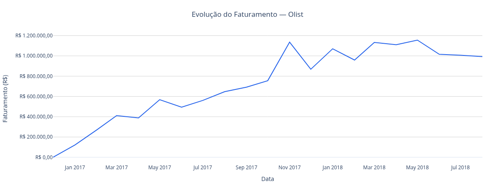
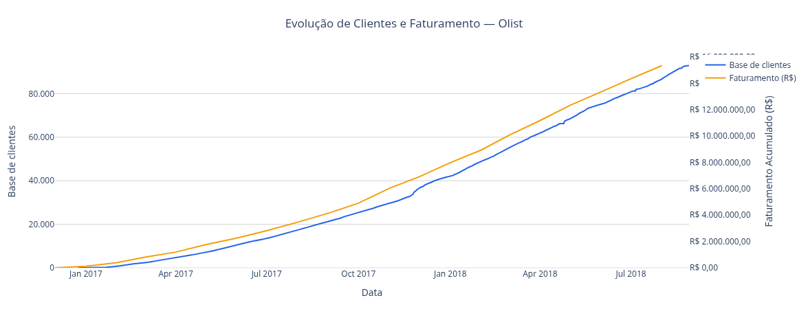
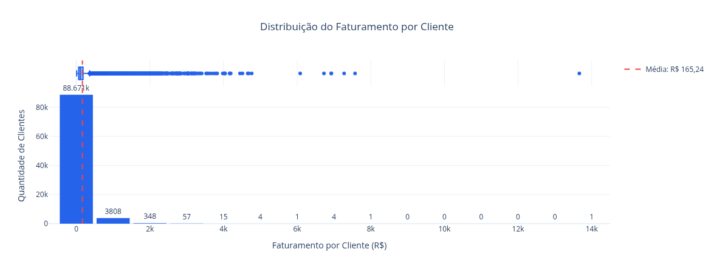

# Portfólio de Ciência de Dados


Olá! Meu nome é Adilson Gabriel de Lacerda Ribeiro e sou bacharel em Física pela Universidade Federal do Paraná. Tenho experiência em exploração de dados e aplico conhecimentos de matemática, estatística e programação para transformar dados em informações relevantes, identificar padrões e tendências e apoiar a tomada de decisões. Tenho interesse em atuar nas áreas de Análise de Dados e Ciência de Dados.

# Projeto: Diagnóstico financeiro da Olist
## Resumo

**Descrição:** Projeto de análise de dados com Python e SQL, desenvolvido a partir de dados da Olist, uma empresa brasileira de comércio eletrônico. O trabalho inclui exploração e preparação dos dados e um diagnóstico dos mecanismos de crescimento do faturamento.

**Objetivo:** Analisar dados de pedidos, pagamentos e clientes referentes ao período de 2016 a 2018 para investigar a evolução do faturamento e responder a questões relevantes para o negócio.

**Problema de negócio:** A análise exploratória identificou uma tendência de crescimento das vendas. Para avaliar se esse crescimento é saudável, o projeto considera que o faturamento deve ter recorrência e não depender excessivamente de poucos clientes. A análise investiga duas questões:

- O crescimento do faturamento é impulsionado pela conquista de novos clientes, pelo aumento da frequência de compra ou pelo aumento do valor das vendas?
- Como o faturamento se distribui entre os clientes? Há concentração relevante?

**Principais resultados:**

- O faturamento cresceu 143,87% entre os períodos comparáveis de 2017 e 2018. O aumento foi acompanhado pelo crescimento de 140,19% no volume de vendas, enquanto o ticket médio variou 1,53%.
- A base de clientes aumentou 147,17%; a frequência média de compra, por sua vez, teve variação negativa de 0,45%.
- O maior faturamento individual por cliente foi de R$ 13.664,08. Cerca de 29,28% dos clientes concentraram 63,9% da receita.

**Recomendações:** Criar ações de recompra e fidelização, identificar clientes inativos e personalizar campanhas com base no histórico de compras para estimular a recorrência. Também é recomendável fortalecer o relacionamento com os clientes que mais contribuem para o faturamento e avaliar iniciativas de upsell e cross-sell para os demais grupos.

## O que você encontrará aqui?

- **Preparação e análise exploratória:** inspeção das tabelas, avaliação de valores ausentes e análise da qualidade e do recorte temporal dos registros.
- **SQL com SQLite:** consultas com `SELECT`, `WHERE`, `INNER JOIN`, `GROUP BY` e `ORDER BY`, além das funções de agregação `SUM` e `COUNT(DISTINCT ...)` e da função de data `strftime`.
- **Views:** criação da view `orders_cleaned` com `CREATE VIEW`, após remover uma versão anterior com `DROP VIEW IF EXISTS`. A view restringe a análise a pedidos entregues no intervalo temporal selecionado.
- **Integração entre Python e SQL:** uso de pandas para carregar os arquivos CSV em tabelas SQLite, executar consultas parametrizadas e trazer os resultados para DataFrames.
- **Análise de negócio:** avaliação do faturamento, do volume de vendas, do ticket médio, da quantidade e frequência de compra dos clientes e da concentração de receita.
- **Visualização e interpretação:** gráficos e indicadores para comunicar tendências, resultados e recomendações.

## Dados

O projeto utiliza três arquivos CSV com dados de clientes, pedidos e pagamentos, além de um banco SQLite. Os arquivos estão armazenados em [`data/`](data/):

| Arquivo | Conteúdo |
|---|---|
| [`olist_customers_dataset.csv`](data/olist_customers_dataset.csv) | Identificadores dos clientes e informações de localização. |
| [`olist_orders_dataset.csv`](data/olist_orders_dataset.csv) | Identificadores, status e datas dos pedidos. |
| [`olist_order_payments_dataset.csv`](data/olist_order_payments_dataset.csv) | Registros de pagamentos associados aos pedidos. |
| [`olist.db`](data/olist.db) | Banco SQLite com as tabelas `customers`, `orders` e `order_payments`, além da view `orders_cleaned`. |

### Dados de clientes

Este conjunto reúne identificadores e informações de localização dos clientes. A relação com a tabela de pedidos é feita por `customer_id`, que identifica o registro do cliente associado a um pedido. Um consumidor que faz pedidos diferentes pode ter um `customer_id` distinto em cada pedido. Já `customer_unique_id` permite reconhecer o mesmo consumidor entre pedidos diferentes.

| Campo | Descrição |
|---|---|
| `customer_id` | Identificador do registro do cliente relacionado ao pedido. |
| `customer_unique_id` | Identificador que permite reconhecer um cliente em diferentes pedidos. |
| `customer_zip_code_prefix` | Prefixo de cinco dígitos do CEP informado para o cliente. |
| `customer_city` | Cidade do cliente. |
| `customer_state` | Estado do cliente. |

### Dados de itens do pedido

O conjunto completo disponibilizado pela Olist no Kaggle também contém informações sobre os itens incluídos em cada pedido, embora esse arquivo não esteja entre os CSVs usados neste projeto. Por exemplo, o pedido `00143d0f86d6fbd9f9b38ab440ac16f5` contém três unidades do mesmo produto. O valor unitário de R$ 21,33 resulta em R$ 63,99 em produtos. Considerando frete de R$ 15,10 por unidade, o frete total é R$ 45,30 e o pedido soma R$ 109,29 entre produtos e frete. O valor do frete de cada item é calculado considerando características como dimensões e peso; quando um pedido inclui vários itens, somam-se os fretes registrados para cada um.

| Campo | Descrição |
|---|---|
| `order_id` | Identificador do pedido ao qual o item pertence. |
| `order_item_id` | Número sequencial que identifica cada item dentro do pedido. |
| `product_id` | Identificador do produto comprado. |
| `seller_id` | Identificador do vendedor responsável pelo item. |
| `shipping_limit_date` | Data-limite para o vendedor encaminhar o item ao parceiro logístico. |
| `price` | Valor do item. |
| `freight_value` | Valor do frete associado ao item. Para calcular o frete total de um pedido com vários itens, somam-se os valores registrados para cada item. |

### Dados de pagamentos

Cada registro descreve uma parcela ou transação de pagamento associada a um pedido. Um pedido pode ter mais de um registro quando o pagamento é dividido entre diferentes métodos ou transações.

| Campo | Descrição |
|---|---|
| `order_id` | Identificador do pedido relacionado ao pagamento. |
| `payment_sequential` | Número sequencial do registro de pagamento dentro do pedido. |
| `payment_type` | Método de pagamento utilizado. |
| `payment_installments` | Número de parcelas informado para o pagamento. |
| `payment_value` | Valor registrado para a transação de pagamento. |

### Dados de pedidos

Esta tabela reúne os pedidos e suas principais datas, conectando cada compra ao cliente correspondente. Os registros de data e hora permitem acompanhar etapas que vão da realização da compra à entrega.

| Campo | Descrição |
|---|---|
| `order_id` | Identificador único do pedido. |
| `customer_id` | Identificador do registro do cliente associado ao pedido. |
| `order_status` | Situação do pedido, como entregue ou enviado. |
| `order_purchase_timestamp` | Data e hora em que o pedido foi realizado. |
| `order_approved_at` | Data e hora da aprovação do pagamento. |
| `order_delivered_carrier_date` | Data e hora em que o pedido foi encaminhado ao parceiro logístico. |
| `order_delivered_customer_date` | Data e hora da entrega efetiva ao cliente. |
| `order_estimated_delivery_date` | Data estimada de entrega informada ao cliente no momento da compra. |

**Fonte dos dados:** [Brazilian E-Commerce Public Dataset by Olist — Kaggle](https://www.kaggle.com/datasets/olistbr/brazilian-ecommerce).

## Etapas da análise

1. **Carga dos dados:** [`main.py`](main.py) lê os três arquivos CSV e grava as tabelas no banco SQLite por meio das funções de [`analytics/queries_sqlite3.py`](analytics/queries_sqlite3.py).
2. **Exploração e preparação:** [`analytics/raw_exploratory_analysis.ipynb`](analytics/raw_exploratory_analysis.ipynb) examina as tabelas, os valores ausentes, os status dos pedidos e a estabilidade dos registros ao longo do tempo.
3. **Seleção dos pedidos:** a função `create_view_cleaned_data()` cria a view `orders_cleaned`, considerando os pedidos entregues com data de compra a partir de 1º de dezembro de 2016 e anterior a 26 de agosto de 2018.
4. **Análise financeira:** [`analytics/analysis.ipynb`](analytics/analysis.ipynb) compara os seguintes indicadores:
   - **Ticket médio:** indica quanto, em média, foi gasto por venda.
   - **Quantidade de vendas:** mostra a evolução do volume de transações.
   - **Quantidade de clientes:** ajuda a avaliar se o crescimento das vendas acompanha a expansão da base de consumidores.
   - **Frequência de compra:** mostra quantas compras, em média, cada cliente realizou no período.
   - **Faturamento por cliente:** evidencia a contribuição de cada consumidor para a receita.
   - **Concentração da receita:** avalia que parcela do faturamento é gerada por diferentes proporções da base de clientes.

   A leitura conjunta desses indicadores ajuda a identificar os fatores associados ao crescimento do faturamento e a avaliar como a receita se distribui entre os clientes. Os resultados também apoiam recomendações de campanhas direcionadas a diferentes grupos de consumidores.
5. **Visualizações:** os notebooks apresentam gráficos temporais, gráficos de distribuição e indicadores resumidos para facilitar a interpretação dos resultados.

## Principais resultados

### Evolução do faturamento



O faturamento passou de R$ 3.461.379,87 em 2017 para R$ 8.441.169,30 no período comparável de 2018, um aumento de **143,87%**. No mesmo intervalo, o número de vendas subiu de 21.921 para 52.651 (**140,19%**), enquanto o ticket médio variou **1,53%**.



A base de clientes aumentou de 20.564 para 50.828 (**147,17%**), enquanto a frequência média de compra variou **-0,45%**.

### Distribuição do faturamento por cliente



O maior faturamento individual por cliente foi de **R$ 13.664,08**. Cerca de **29,28% dos clientes** responderam por **63,9% da receita**, equivalente a **R$ 9.810.944,74**.

## Como executar

1. Baixe do Kaggle os três arquivos CSV listados na tabela acima e coloque-os na pasta `data/`.
2. Instale as dependências listadas em [`requirements.txt`](requirements.txt).
3. Para recriar as tabelas e a view a partir dos CSVs, execute na raiz do projeto:

   ```bash
   python main.py
   ```

4. Abra os notebooks em `analytics/`. Para que o import `queries_sqlite3` seja resolvido como no projeto, configure `analytics/` como diretório de trabalho do kernel.

## Considerações e limitações

**Conclusão:** De acordo com o critério adotado, o faturamento cresceu principalmente junto com a expansão da base de clientes, sem aumento relevante da frequência de compra. A receita não depende de um único consumidor, mas uma parcela expressiva do faturamento está concentrada em parte da base, o que torna importantes as ações de retenção e fidelização.

**Limitações:** Para realizar uma análise mais completa da sustentabilidade do crescimento, seria necessário avaliar a retenção de clientes, a recorrência da receita, a evolução das margens e a concentração das vendas por vendedor ou região. Essas análises, no entanto, não foram contempladas neste trabalho, que se limita a apresentar um diagnóstico geral dos mecanismos de crescimento da receita. Além disso, os dados de 2018 estão incompletos devido ao truncamento da série histórica ao final do período. Portanto, as comparações devem considerar esse recorte, uma vez que os resultados não representam um ano completo.